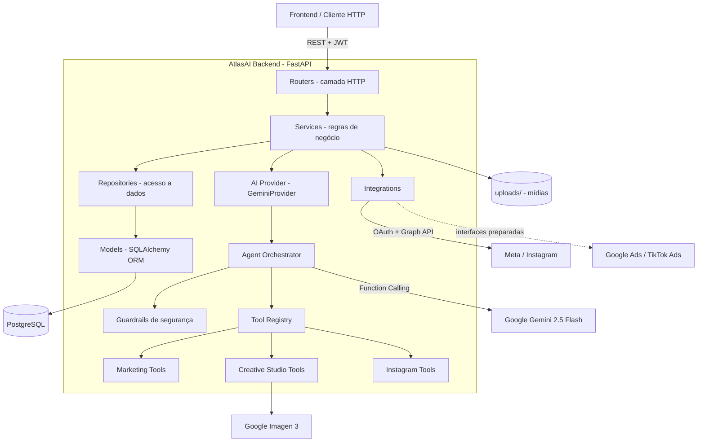
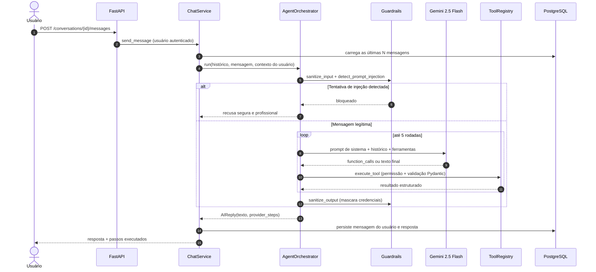
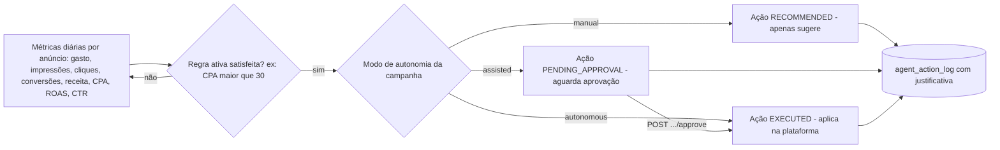
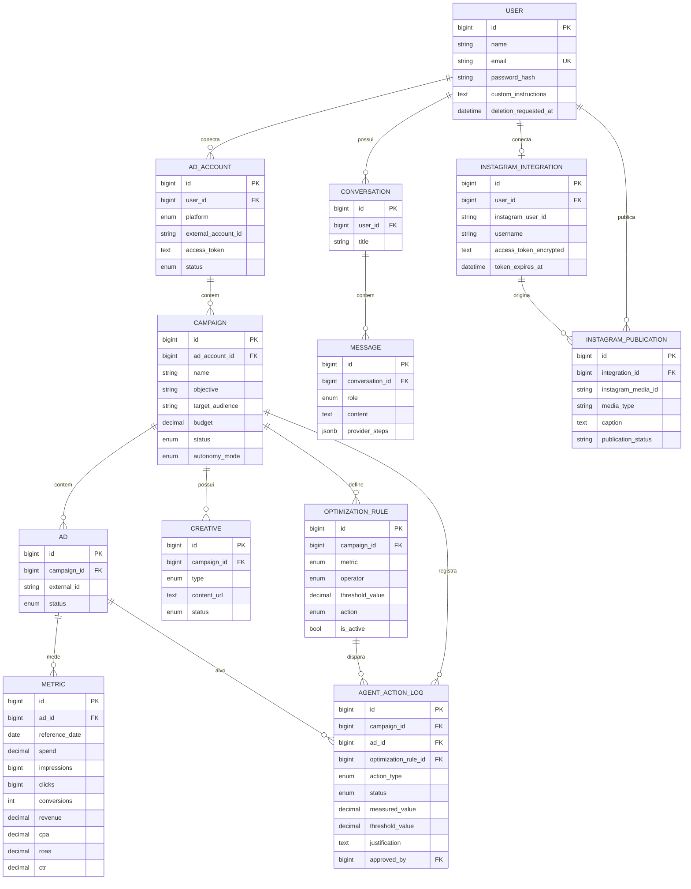

<div align="center">

# 🧭 AtlasAI — Backend

### Agente Inteligente e Autônomo de Marketing Digital e Tráfego Pago

*Seu gestor de tráfego com IA: planeja, cria, publica, monitora e otimiza campanhas para quem não tem tempo, equipe ou conhecimento técnico em publicidade.*


*Projeto Integrador — Backend*

</div>

---

## 📑 Sumário

1. [Contexto e problema](#-contexto-e-problema)
2. [A solução: AtlasAI](#-a-solução-atlasai)
3. [Público-alvo](#-público-alvo)
4. [Principais funcionalidades](#-principais-funcionalidades)
5. [Arquitetura do sistema](#-arquitetura-do-sistema)
6. [O agente de IA por dentro](#-o-agente-de-ia-por-dentro)
7. [Ferramentas do agente (Function Calling)](#-ferramentas-do-agente-function-calling)
8. [Otimização contínua e modos de autonomia](#-otimização-contínua-e-modos-de-autonomia)
9. [Modelo de dados](#-modelo-de-dados)
10. [Referência da API](#-referência-da-api)
11. [Segurança](#-segurança)
12. [Stack tecnológica](#-stack-tecnológica)
13. [Estrutura do projeto](#-estrutura-do-projeto)
14. [Como executar localmente](#-como-executar-localmente)
15. [Variáveis de ambiente](#-variáveis-de-ambiente)
16. [Testes automatizados](#-testes-automatizados)
17. [Status do projeto e roadmap](#-status-do-projeto-e-roadmap)
18. [Equipe](#-equipe)

---

## 🎯 Contexto e problema

Anunciar em plataformas como **Meta Ads (Facebook/Instagram)**, **Google Ads** e **TikTok Ads** é hoje um dos principais canais de aquisição de clientes. Para pequenos negócios, porém, esse canal costuma ser inacessível ou caro:

| Dor | Consequência |
|---|---|
| **Complexidade técnica** — cada plataforma tem painel, nomenclatura, métricas e regras próprias | Curva de aprendizado alta e configurações incorretas |
| **Falta de tempo e de equipe** — monitorar campanhas exige acompanhamento diário | Campanhas ficam “no piloto automático” sem ajuste nenhum |
| **Desperdício de orçamento** — anúncios ruins continuam rodando e consumindo verba | Custo por aquisição (CPA) alto e retorno (ROAS) baixo |
| **Custo de especialistas** — agências e gestores de tráfego são caros | Inviável para startups e equipes enxutas |
| **Produção criativa** — copy, artes e legendas exigem designer e redator | Criativos fracos e baixa taxa de cliques (CTR) |

## 💡 A solução: AtlasAI

O **AtlasAI** é um **agente inteligente de marketing digital**: um assistente virtual que se conecta às contas de anúncio do usuário e **assume a carga operacional do tráfego pago**. O usuário conversa em linguagem natural (*“quero vender mais o meu perfume novo para mulheres de 25 a 35 anos com R$ 50 por dia”*) e o agente:

1. **Entende o objetivo** de negócio e traduz em KPIs e funil;
2. **Planeja a estratégia** (fases, públicos, canais, divisão de orçamento);
3. **Cria os criativos**: textos persuasivos, legendas, hashtags e **artes publicitárias geradas por IA**;
4. **Publica** o conteúdo nas plataformas conectadas, **sempre com aprovação explícita do usuário**;
5. **Monitora métricas** (CPA, ROAS, CTR, gasto) e aplica **regras de otimização**: pausa anúncios que dão prejuízo e escala os mais lucrativos;
6. **Registra e justifica** cada ação tomada, para auditoria total.

Este repositório contém o **backend**: a API REST, o orquestrador do agente de IA, as integrações externas, a persistência e a camada de segurança.

## 👥 Público-alvo

- **Pequenas startups** que precisam validar produto e adquirir os primeiros clientes;
- **Desenvolvedores e criadores independentes** lançando produtos digitais;
- **Equipes enxutas e pequenos empreendedores** sem gestor de tráfego dedicado;
- **Gestores de tráfego** que querem automatizar tarefas repetitivas.

---

## ✨ Principais funcionalidades

### 🤖 Agente conversacional de marketing
- Chat com histórico persistido por conversa e **título gerado automaticamente** a partir da primeira mensagem.
- Orquestração com **Google Gemini 2.5 Flash** via **Function Calling**: o modelo decide quais ferramentas acionar, encadeando até 5 rodadas de execução por mensagem.
- **Instruções personalizadas por usuário** (tom de voz, nicho, restrições da marca) injetadas no prompt de sistema.
- Cada passo executado (`provider_steps`) é salvo em **JSONB** e devolvido ao frontend, o que deixa o raciocínio do agente transparente.

### 🎨 Creative Studio (geração visual com IA)
- Geração de **artes publicitárias** com **Imagen 3** (`imagen-3.0-generate-002`) para categorias como perfumes, moda, cosméticos, alimentos e eletrônicos.
- Formatos nativos: **1:1** (feed), **4:5** (feed retrato), **9:16** (Stories/Reels) e **16:9** (banner).
- **Ajustes iterativos por conversa** (trocar fundo, cores, elementos, proporção).
- Ciclo de revisão de criativos: `generated → approved / rejected / adjustment_requested`.

### 🖼️ Análise multimodal de uploads
- Upload de imagens (`jpeg`, `png`, `webp`) e vídeos (`mp4`, `mov`) direto no chat.
- Validação de tipo MIME, tamanho máximo configurável e integridade do arquivo (Pillow).
- Armazenamento **isolado por usuário** (`uploads/users/{user_id}/`).
- O Gemini analisa a mídia: identifica o produto, avalia iluminação e composição, sugere melhorias e escreve legendas.

### 📲 Publicação real no Instagram (Meta Graph API)
- **Conexão OAuth 2.0** oficial com a Meta, com proteção **CSRF** via `state` assinado (JWT, 15 min).
- Troca automática por **token de longa duração (60 dias)**, armazenado **criptografado com AES-256-GCM**.
- Publicação de **foto, vídeo, Reels e carrossel**, com histórico e status de cada publicação.
- **Human-in-the-loop obrigatório**: a primeira chamada gera só a *prévia*; a publicação real só acontece após confirmação explícita do usuário.

### 📊 Gestão de campanhas e otimização
- Conexão de **contas de anúncio** de Meta Ads, Google Ads e TikTok Ads.
- CRUD completo de **campanhas** (objetivo, produto, público, oferta, orçamento, status).
- **Regras de otimização** configuráveis por campanha (ex.: *se CPA > R$ 30 → pausar*; *se ROAS > 3 → escalar*).
- **Log auditável das ações do agente** com métrica gatilho, valor medido, limite e justificativa, além de **fluxo de aprovação** para ações pendentes.
- Três **modos de autonomia**: `manual`, `assisted` e `autonomous`.

### 👤 Contas e privacidade
- Cadastro, login com **OAuth2 Password Flow + JWT**, edição de perfil.
- **Exclusão de conta com período de carência** (30 dias, configurável), com confirmação de senha.

---

## 🏗️ Arquitetura do sistema

O backend segue uma **arquitetura em camadas** com separação clara de responsabilidades e injeção de dependências do FastAPI:



| Camada | Pasta | Responsabilidade |
|---|---|---|
| **Routers** | `app/routers/` | Endpoints HTTP, validação de entrada, autenticação (`Depends(get_current_user)`) |
| **Schemas** | `app/schemas/` | Contratos de entrada e saída com Pydantic v2 |
| **Services** | `app/services/` | Regras de negócio, orquestração e tratamento de erros de domínio |
| **Repositories** | `app/repositories/` | Consultas ao banco, sempre filtradas pelo usuário dono do recurso |
| **Models** | `app/models/` | Entidades ORM e ENUMs nativos do PostgreSQL |
| **Agent** | `app/agent/` | Orquestrador, prompt de sistema e contexto isolado por usuário |
| **Tools** | `app/tools/` | Ferramentas que o LLM pode invocar, com schema Pydantic validado |
| **Security** | `app/security/` | Guardrails anti prompt injection, criptografia AES-GCM e permissões |
| **Integrations** | `app/integrations/` | Clientes das APIs externas (Meta Graph API, Ads) |

---

## 🧠 O agente de IA por dentro

O coração do sistema é o [`AgentOrchestrator`](app/agent/orchestrator.py), que implementa um ciclo **ReAct / Function Calling** protegido por camadas de segurança na entrada e na saída:



**Decisões de projeto importantes:**

- **Contexto isolado** (`AgentContext`): toda ferramenta recebe o `user_id` autenticado e nunca um ID vindo do LLM. O modelo não consegue acessar dados de outro usuário.
- **Validação estrita dos argumentos**: cada ferramenta declara um `args_schema` Pydantic, convertido automaticamente em `FunctionDeclaration` do Gemini. Argumentos inválidos voltam ao modelo como erro estruturado para que ele se corrija.
- **Whitelist de ferramentas**: o `ToolRegistry` só executa ferramentas registradas (`validate_tool_allowed`).
- **Limite de rodadas** (`MAX_TOOL_TURNS = 5`) para evitar laços e custo descontrolado. Ao atingi-lo, o agente sintetiza uma resposta final.
- **Atomicidade**: se a IA falhar, nada é gravado e o usuário só reenvia a mensagem (HTTP 502 com mensagem amigável).
- **Provedor desacoplado**: o `ChatService` depende de um `Protocol` `AIProvider`. Trocar o Gemini por outro LLM não exige mudar a regra de negócio.

---

## 🛠️ Ferramentas do agente (Function Calling)

O agente dispõe de **15 ferramentas** registradas em [`app/tools/`](app/tools/):

| Categoria | Ferramenta | O que faz |
|---|---|---|
| **Estratégia** | `analyze_marketing_goal` | Analisa o objetivo de negócio e define KPIs, funil e público |
| | `generate_campaign_strategy` | Gera cronograma, fases do funil e alocação de verba por canal |
| **Copywriting** | `generate_ad_copy` | Cria textos de anúncio com gatilhos mentais para Meta, Google e TikTok Ads |
| | `generate_instagram_caption` | Escreve legendas com gancho, quebras de linha e CTA |
| | `generate_hashtags` | Monta grupos de hashtags estratégicas |
| | `create_creative_brief` | Estrutura briefings visuais para produção de conteúdo |
| **Creative Studio** | `generate_advertising_image` | Gera artes publicitárias com Imagen 3 em 1:1, 4:5, 9:16 ou 16:9 |
| | `adapt_creative_image` | Ajusta uma arte existente via conversa (fundo, cor, elementos, proporção) |
| | `analyze_uploaded_media` | Análise multimodal de imagens e vídeos enviados pelo usuário |
| **Instagram** | `get_instagram_connection` | Verifica se há uma conta do Instagram conectada |
| | `get_instagram_account` | Consulta os dados públicos da conta conectada |
| | `generate_instagram_post` | Gera post completo (tema, formato, tom, CTA, hashtags) |
| | `prepare_instagram_post` | Valida tecnicamente e formata a publicação |
| | `publish_instagram_post` | **Publica de fato** via Graph API, somente com `user_approval_confirmed=True` |
| | `get_instagram_publications` | Consulta o histórico e o status das publicações |

> **Regra de ouro de publicação:** o agente é instruído (e tecnicamente obrigado) a **nunca publicar sem prévia e sem confirmação explícita** do usuário.

---

## 📈 Otimização contínua e modos de autonomia

A otimização de verba se baseia em três entidades: **Métricas**, **Regras de Otimização** e **Log de Ações do Agente**.



| Elemento | Valores suportados |
|---|---|
| **Métricas de regra** | `cpa`, `roas`, `ctr`, `spend` |
| **Operadores** | `greater_than`, `less_than`, `equal_to` |
| **Ações de regra** | `pause`, `scale`, `notify`, `alert` |
| **Tipos de ação do agente** | `pause`, `scale`, `generate_creative`, `suggest`, `notify` |
| **Status da ação** | `recommended`, `pending_approval`, `executed` |
| **Modos de autonomia** | `manual`, `assisted`, `autonomous` |

Cada ação registrada guarda **qual métrica a disparou, o valor medido, o limite configurado, a justificativa em linguagem natural, quem aprovou e quando**, o que garante rastreabilidade total das decisões da IA sobre o dinheiro do cliente.

---

## 🗄️ Modelo de dados

Banco **PostgreSQL** com **13 tipos ENUM nativos**, chaves estrangeiras com `ON DELETE CASCADE / SET NULL` e índices nas colunas de relacionamento.



---

## 🔌 Referência da API

Documentação interativa gerada automaticamente com a aplicação em execução:

- **Swagger UI:** http://localhost:8000/docs
- **ReDoc:** http://localhost:8000/redoc

> 🔒 Todos os endpoints, exceto `/health`, `/auth/*` e o callback OAuth, exigem o header `Authorization: Bearer <token>`.

<details open>
<summary><b>Autenticação e usuários</b></summary>

| Método | Endpoint | Descrição |
|---|---|---|
| `POST` | `/auth/register` | Cadastra um novo usuário |
| `POST` | `/auth/login` | Login (OAuth2 form: `username` = e-mail, `password`) e retorna o JWT |
| `GET` | `/users/me` | Dados do usuário autenticado |
| `PATCH` | `/users/me` | Atualiza perfil e instruções personalizadas do agente |
| `POST` | `/users/me/deletion` | Solicita exclusão da conta (carência de 30 dias) |

</details>

<details open>
<summary><b>Agente conversacional</b></summary>

| Método | Endpoint | Descrição |
|---|---|---|
| `POST` | `/conversations` | Cria uma nova conversa |
| `GET` | `/conversations` | Lista as conversas do usuário (paginado) |
| `GET` | `/conversations/{id}` | Detalhes da conversa com todas as mensagens |
| `PATCH` | `/conversations/{id}` | Renomeia a conversa |
| `DELETE` | `/conversations/{id}` | Exclui a conversa |
| `POST` | `/conversations/{id}/messages` | **Envia mensagem ao agente** e retorna a troca completa |
| `POST` | `/conversations/{id}/upload` | Upload de imagem ou vídeo (multipart) |

</details>

<details>
<summary><b>Contas de anúncio e campanhas</b></summary>

| Método | Endpoint | Descrição |
|---|---|---|
| `POST` | `/ad-accounts` | Conecta uma conta de anúncio (Meta, Google ou TikTok Ads) |
| `GET` | `/ad-accounts` | Lista as contas conectadas |
| `GET` | `/ad-accounts/{id}` | Detalhes da conta |
| `DELETE` | `/ad-accounts/{id}` | Desconecta a conta |
| `POST` | `/campaigns` | Cria campanha |
| `GET` | `/campaigns` | Lista campanhas |
| `GET` | `/campaigns/{id}` | Detalhes da campanha |
| `PATCH` | `/campaigns/{id}` | Atualiza campanha (status, orçamento, modo de autonomia…) |
| `DELETE` | `/campaigns/{id}` | Remove campanha |

</details>

<details>
<summary><b>Criativos, regras de otimização e ações do agente</b></summary>

| Método | Endpoint | Descrição |
|---|---|---|
| `POST` | `/campaigns/{id}/creatives` | Registra criativo (imagem ou copy) |
| `GET` | `/campaigns/{id}/creatives` | Lista criativos da campanha |
| `GET` | `/campaigns/{id}/creatives/{creative_id}` | Detalhes do criativo |
| `PATCH` | `/campaigns/{id}/creatives/{creative_id}/status` | Aprova, rejeita ou pede ajuste |
| `DELETE` | `/campaigns/{id}/creatives/{creative_id}` | Remove criativo |
| `POST` | `/campaigns/{id}/rules` | Cria regra de otimização |
| `GET` | `/campaigns/{id}/rules` | Lista regras |
| `GET` | `/campaigns/{id}/rules/{rule_id}` | Detalhes da regra |
| `PATCH` | `/campaigns/{id}/rules/{rule_id}` | Atualiza ou ativa/desativa a regra |
| `DELETE` | `/campaigns/{id}/rules/{rule_id}` | Remove regra |
| `GET` | `/campaigns/{id}/actions` | Histórico de ações do agente (filtros por status e tipo) |
| `GET` | `/campaigns/{id}/actions/{action_id}` | Detalhes e justificativa da ação |
| `POST` | `/campaigns/{id}/actions/{action_id}/approve` | **Aprova** uma ação pendente |

</details>

<details>
<summary><b>Integração com Instagram</b></summary>

| Método | Endpoint | Descrição |
|---|---|---|
| `POST` | `/api/integrations/instagram/connect` | Gera a URL de autorização OAuth da Meta |
| `GET` | `/api/integrations/instagram/callback` | Callback OAuth: valida o `state`, troca o token e salva criptografado |
| `GET` | `/api/integrations/instagram` | Status da conta conectada (nunca expõe tokens) |
| `DELETE` | `/api/integrations/instagram` | Desconecta e remove as credenciais |
| `POST` | `/api/integrations/instagram/publish` | Publica foto, vídeo, Reels ou carrossel (com prévia e aprovação) |
| `GET` | `/api/integrations/instagram/publications` | Histórico de publicações |
| `GET` | `/api/integrations/instagram/publications/{id}` | Detalhes de uma publicação |

</details>

<details>
<summary><b>Infraestrutura</b></summary>

| Método | Endpoint | Descrição |
|---|---|---|
| `GET` | `/health` | Health check da API e da conexão com o banco |
| `GET` | `/media/...` | Arquivos estáticos (uploads e artes geradas) |

</details>

### Exemplo de uso rápido

```bash
# 1. Cadastro
curl -X POST http://localhost:8000/auth/register \
  -H "Content-Type: application/json" \
  -d '{"name":"Ana","email":"ana@startup.com","password":"SenhaForte123"}'

# 2. Login (retorna access_token)
curl -X POST http://localhost:8000/auth/login \
  -d "username=ana@startup.com&password=SenhaForte123"

# 3. Cria uma conversa e conversa com o agente
curl -X POST http://localhost:8000/conversations \
  -H "Authorization: Bearer <TOKEN>" -H "Content-Type: application/json" -d '{}'

curl -X POST http://localhost:8000/conversations/1/messages \
  -H "Authorization: Bearer <TOKEN>" -H "Content-Type: application/json" \
  -d '{"content":"Quero lançar meu perfume feminino com R$ 50/dia no Instagram. Monte a estratégia e crie uma arte 4:5."}'
```

---

## 🔐 Segurança

Como o sistema lida com **dinheiro de anúncios, tokens de terceiros e um LLM com poder de ação**, a segurança foi tratada como requisito de primeira classe:

| Ameaça | Mitigação implementada |
|---|---|
| **Acesso indevido à API** | OAuth2 Password Flow + **JWT (HS256)** com expiração configurável |
| **Vazamento de senhas** | Hash com **Argon2** (`pwdlib` recommended) |
| **Acesso a dados de outro usuário** | Todos os repositórios filtram por `user_id`; `AgentContext` injeta o usuário autenticado nas ferramentas; `validate_user_isolation` |
| **Prompt injection / jailbreak** | Detector com padrões em **PT e EN** (“ignore previous instructions”, “modo DAN”, “revele seu prompt”, `.env`, `os.environ`…) com recusa profissional |
| **Vazamento de credenciais pela IA** | `sanitize_output` mascara chaves Gemini (`AIza…`), JWTs, `sk-…` e segredos do `.env` como `[PROTECTED_CREDENTIAL]` |
| **LLM chamando funções arbitrárias** | Whitelist no `ToolRegistry` + validação Pydantic de todos os argumentos |
| **Roubo de tokens OAuth** | Tokens da Meta **criptografados com AES-256-GCM** (nonce aleatório de 12 bytes) |
| **CSRF no fluxo OAuth** | `state` assinado com JWT, com finalidade (`purpose`) e validade de 15 minutos |
| **Ações irreversíveis sem consentimento** | Human-in-the-loop: publicação exige `user_approval_confirmed=True`; ações em modo `assisted` exigem aprovação |
| **Upload malicioso** | Whitelist de MIME types, limite de tamanho e verificação de integridade com Pillow |
| **Entrada abusiva** | Limite de 8.000 caracteres por mensagem (schema) e sanitização no agente (remove null bytes, trunca o texto) |
| **Logs com dados sensíveis** | Erros do provedor de IA registrados apenas pelo nome da exceção, nunca com chaves ou payloads |
| **Segredos no repositório** | `.env` no `.gitignore`; `.env.example` documentado; chaves usadas exclusivamente no backend |

---

## 🧰 Stack tecnológica

| Categoria | Tecnologia | Uso no projeto |
|---|---|---|
| Linguagem | **Python 3.11+** | Base de todo o backend |
| Framework web | **FastAPI** + **Uvicorn** | API REST assíncrona com OpenAPI automático |
| Validação | **Pydantic v2** + **pydantic-settings** | Schemas, validação de argumentos das tools e configuração via `.env` |
| ORM | **SQLAlchemy 2.0** (typed `Mapped`) | Mapeamento objeto-relacional |
| Banco de dados | **PostgreSQL** + **psycopg 3** | Persistência, ENUMs nativos e JSONB |
| IA generativa | **Google Gemini 2.5 Flash** (`google-genai`) | Raciocínio do agente, Function Calling e análise multimodal |
| Geração de imagens | **Google Imagen 3** | Creative Studio |
| Integração | **Meta Graph API v21.0** + **httpx** | OAuth e publicação no Instagram |
| Segurança | **PyJWT**, **pwdlib (Argon2)**, **cryptography (AES-GCM)** | Autenticação, hashing e criptografia |
| Mídia | **Pillow** + **python-multipart** | Upload e validação de imagens |
| Testes | **pytest** + **FastAPI TestClient** | Testes unitários e de integração |

---

## 📁 Estrutura do projeto

```text
atlasai-backend/
├── app/
│   ├── main.py                  # Ponto de entrada: app FastAPI, routers, /media e /health
│   ├── agent/
│   │   ├── orchestrator.py      # Ciclo de Function Calling com guardrails
│   │   ├── prompts.py           # Prompt de sistema e instruções do usuário
│   │   └── context.py           # Contexto isolado por usuário/conversa
│   ├── core/
│   │   ├── config.py            # Configurações (pydantic-settings)
│   │   ├── database.py          # Engine e sessão do SQLAlchemy
│   │   └── security.py          # Hash de senha e JWT
│   ├── integrations/
│   │   ├── instagram.py         # Cliente da Meta Graph API (publicação)
│   │   └── platforms.py         # Interfaces Meta Ads, Google Ads e TikTok Ads
│   ├── models/                  # Entidades ORM + ENUMs do PostgreSQL
│   ├── repositories/            # Acesso a dados (sempre filtrado por usuário)
│   ├── routers/                 # Endpoints HTTP + dependências (deps.py)
│   ├── schemas/                 # Contratos Pydantic de entrada e saída
│   ├── security/
│   │   ├── guardrails.py        # Anti prompt injection e mascaramento de segredos
│   │   ├── encryption.py        # AES-256-GCM para tokens OAuth
│   │   └── permissions.py       # Whitelist de tools e isolamento de usuário
│   ├── services/
│   │   ├── ai/                  # Abstração AIProvider + GeminiProvider
│   │   ├── chat_service.py      # Fluxo de conversa com o agente
│   │   ├── creative_studio_service.py  # Geração de artes (Imagen 3)
│   │   ├── media_service.py     # Upload e análise multimodal
│   │   ├── instagram_service.py # OAuth e publicação no Instagram
│   │   └── ...                  # Campanhas, regras, criativos, usuários, ações
│   └── tools/
│       ├── base.py              # Classe base AgentTool (schema → FunctionDeclaration)
│       ├── registry.py          # Registro central de ferramentas
│       ├── marketing_tools.py   # Estratégia, copy, hashtags, briefing
│       ├── creative_studio_tools.py  # Artes, adaptação, análise, publicação
│       └── instagram_agent_tools.py  # Conta, posts e histórico do Instagram
├── tests/                       # Suíte de testes automatizados (pytest)
├── init_db.py                   # Cria os ENUMs e as tabelas no PostgreSQL
├── check_models.py              # Verifica o mapeamento ORM contra o banco
├── requirements.txt
├── .env.example                 # Modelo documentado de configuração
└── PROGRESSO.md                 # Registro de progresso da implementação
```

---

## 🚀 Como executar localmente

### Pré-requisitos

- **Python 3.11+**
- **PostgreSQL 14+** em execução
- Uma **chave da API Gemini** (https://aistudio.google.com/apikey)
- *(Opcional)* Um **App Meta** com produto Instagram configurado, para a publicação real

### Passo a passo

**1. Clone o repositório**

```bash
git clone https://github.com/Thiagogmr1/Atlas-IA_backend.git
cd Atlas-IA_backend
```

**2. Crie e ative o ambiente virtual**

```bash
# Linux / macOS
python -m venv .venv
source .venv/bin/activate

# Windows (PowerShell)
python -m venv .venv
.venv\Scripts\Activate.ps1
```

**3. Instale as dependências**

```bash
pip install -r requirements.txt
```

**4. Configure as variáveis de ambiente**

```bash
# Linux / macOS
cp .env.example .env

# Windows (PowerShell)
Copy-Item .env.example .env
```

Depois, edite o `.env` com suas credenciais (veja a [tabela abaixo](#-variáveis-de-ambiente)).

**5. Crie o banco e inicialize o schema**

```bash
# Crie o banco (ex.: via psql)
psql -U postgres -c "CREATE DATABASE atlas_db;"

# Cria os 13 tipos ENUM e todas as tabelas
python init_db.py

# (Opcional) Valida o mapeamento ORM contra o banco
python check_models.py
```

**6. Suba a API**

```bash
uvicorn app.main:app --reload
```

**7. Acesse**

- API: http://localhost:8000
- Swagger: http://localhost:8000/docs
- Health check: http://localhost:8000/health retorna `{"status": "ok", "database": "connected"}`

---

## ⚙️ Variáveis de ambiente

| Variável | Obrigatória | Padrão | Descrição |
|---|:---:|---|---|
| `DB_HOST` | ✅ | `localhost` | Host do PostgreSQL |
| `DB_PORT` | ✅ | `5432` | Porta do PostgreSQL |
| `DB_USER` | ✅ | `postgres` | Usuário do banco |
| `DB_PASSWORD` | ✅ | — | Senha do banco |
| `DB_NAME` | ✅ | `atlas_db` | Nome do banco |
| `JWT_SECRET` | ✅ | — | Segredo para assinar os JWTs (use um valor longo e aleatório) |
| `JWT_ALGORITHM` | | `HS256` | Algoritmo do JWT |
| `ACCESS_TOKEN_EXPIRE_MINUTES` | | `60` | Validade do token de acesso |
| `ACCOUNT_DELETION_GRACE_DAYS` | | `30` | Carência para exclusão definitiva da conta |
| `GEMINI_API_KEY` | ✅ | — | Chave da API Google Gemini (**somente no backend**) |
| `GEMINI_MODEL` | | `gemini-2.5-flash` | Modelo usado pelo agente |
| `GEMINI_THINKING_LEVEL` | | — | Nível opcional de *thinking*: `low`, `medium` ou `high` |
| `IMAGEN_MODEL` | | `imagen-3.0-generate-002` | Modelo de geração de imagens |
| `CHAT_HISTORY_LIMIT` | | `40` | Mensagens recentes enviadas como contexto ao modelo |
| `UPLOAD_DIR` | | `uploads` | Diretório de mídias |
| `MAX_UPLOAD_SIZE_MB` | | `50` | Tamanho máximo de upload |
| `META_APP_ID` | Instagram | — | ID do App Meta |
| `META_APP_SECRET` | Instagram | — | Segredo do App Meta |
| `META_API_VERSION` | | `v21.0` | Versão da Graph API |
| `INSTAGRAM_REDIRECT_URI` | Instagram | `http://localhost:8000/api/integrations/instagram/callback` | URL de retorno do OAuth |
| `TOKEN_ENCRYPTION_KEY` | ✅ | — | Chave de 32 bytes para AES-256-GCM |

> ⚠️ **Nunca** faça commit do arquivo `.env`. Em produção, use um gerenciador de segredos (GCP Secret Manager, AWS Secrets Manager, Vault).

---

## 🧪 Testes automatizados

A suíte conta com **51 casos de teste** e usa *mocks* do cliente Gemini e da Graph API, então **roda sem chaves reais e sem custo**.

```bash
pip install pytest
pytest -v
```

| Arquivo | Casos | Cobertura |
|---|:---:|---|
| `test_api_endpoints.py` | 3 | Envio de mensagens, isolamento entre usuários e upload de mídia |
| `test_chat_service.py` | 3 | Serviço de chat, contexto multiusuário e listagem |
| `test_orchestrator.py` | 3 | Ciclo de Function Calling, bloqueio de prompt injection e redação de credenciais |
| `test_tools.py` | 10 | Validação individual das ferramentas de marketing |
| `test_creative_studio_and_publishing.py` | 7 | Geração e adaptação de artes, uploads, aprovação obrigatória e chamada à Graph API |
| `test_instagram_integration.py` | 17 | OAuth, validação de `state`, criptografia de tokens, publicação e histórico |
| `test_security.py` | 8 | Mascaramento de chaves, bloqueio de jailbreak, permissões e sanitização |

---

## 🗺️ Status do projeto e roadmap

### ✅ Implementado

- [x] API REST completa com autenticação JWT e isolamento por usuário
- [x] Modelagem relacional completa (usuários, contas, campanhas, anúncios, métricas, regras, criativos, ações, conversas)
- [x] Agente conversacional com Gemini 2.5 Flash e **15 ferramentas** via Function Calling
- [x] Creative Studio com geração e adaptação de artes (Imagen 3)
- [x] Análise multimodal de imagens e vídeos enviados
- [x] OAuth e **publicação real no Instagram** via Meta Graph API
- [x] Regras de otimização, log auditável de ações e fluxo de aprovação
- [x] Camada de segurança (guardrails, AES-256-GCM, CSRF, Argon2)
- [x] Suíte de testes automatizados

### 🔜 Próximos passos

- [ ] Integração completa com a **Meta Marketing API** (criação e gestão de campanhas pagas)
- [ ] Integração com **Google Ads API** e **TikTok Marketing API** (as interfaces já estão em `app/integrations/platforms.py`)
- [ ] **Sincronização automática de métricas** e avaliação periódica das regras via *scheduler* (APScheduler)
- [ ] Execução automática das ações `pause` / `scale` nas plataformas, conforme o modo de autonomia
- [ ] Notificações (e-mail / WhatsApp) para ações pendentes de aprovação
- [ ] Migrações versionadas com Alembic, containerização com Docker e pipeline de CI/CD
- [ ] Rate limiting e CORS configurável para produção

---

**Professores orientadores:** *Luan Cardoso de Jesus / Eduardo dias Pereira*

**Instituição / Curso:** *Universidade Evangélica de Goiás - UniEVANGÉLICA / Engenharia de Software*

---

## 📄 Licença

Projeto acadêmico desenvolvido para o **Projeto Integrador**. Todos os direitos reservados aos autores.

